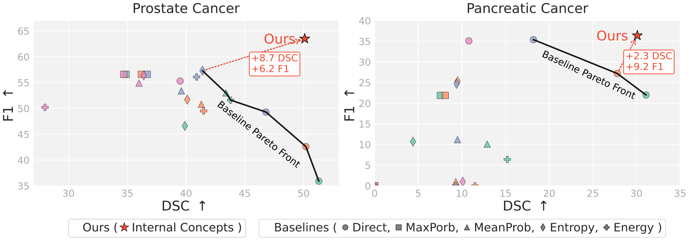

<div align="center">

# MedFoE

**Medical AI Encodes a “Feeling of Error”:<br>Verifying Cancer Segmentation via Internal Concepts**

Mengmeng Ma · Yunxiang Peng · Tang Li · Lu Lin · Binsheng Zhao · Oguz Akin · Xi Peng

**ECCV 2026**

[Paper](https://arxiv.org/abs/2609.08879) · [Weights](#weights) · [Run](#prediction-and-evaluation) · [Concepts](#concept-localization) · [Citation](#citation)

</div>

MedFoE uses sparse autoencoders (SAEs) to read a segmentation model's internal features and detect errors. This release runs **PI-CAI prediction and evaluation with the released checkpoints**. It also includes the five paper baseline methods and one concept-localization example.

## Paper results



**Figure 5:** Published PI-CAI results on the left and PanTS results on the right. This code release focuses on PI-CAI.

The released weights and settings support inference and evaluation. Exact numerical reproduction of every Figure 5 operating point is unverified. Segmentation and SAE training-case membership is not fully documented, so patient-independent validation is not established for these weights.

## Setup

Use Python 3.10. Clone the repository and install the tested dependencies:

```bash
git clone https://github.com/deep-real/CancerSegFailure.git
cd CancerSegFailure
pip install -r requirements.txt
```

### Weights

Download the weights from the **[MedFoE checkpoint folder](https://myuva-my.sharepoint.com/:f:/g/personal/wkb9cb_virginia_edu/IgCxHn7oKBf3Sby6QxQqjK_7AbRlH1Ct4xrgnJQ00jxQOAc?e=0dLxJs)** and place them in `checkpoints/`, keeping this structure:

| Files | Purpose |
|---|---|
| `segmentation.pth` | Segmentation model |
| `sae/6200/` and `sae/10000/` | Six SAEs per step: `layer_1.pt`, `layer_3.pt`, `layer_5.pt`, `layer_7.pt`, `layer_9.pt`, `layer_11.pt` |
| `detectors/6200/` | `patch_detector.joblib`, `patch_scaler.joblib`, `image_detector.joblib`, `image_scaler.joblib` |
| `detectors/10000.joblib` | Complementary detectors and scalers |
| `boundary.joblib` | Boundary model |

The default configuration is [configs/picai.json](configs/picai.json). Edit its paths only if you store the weights elsewhere.

### Data

Download the [PI-CAI MRI scans](https://pi-cai.grand-challenge.org/DATA/) and your chosen [cancer annotations](https://github.com/DIAGNijmegen/picai_labels). Keep the raw image layout: `images/PATIENT/PATIENT_STUDY_t2w.mha`, with matching `_adc.mha` and `_hbv.mha` files. The annotation directory must contain `PATIENT_STUDY.nii.gz` cancer masks.

To prepare one examination, replace `PATIENT_STUDY` with its PI-CAI study ID:

```bash
python prepare.py --images-dir /path/to/images --labels-dir /path/to/cancer_annotations \
  --cases PATIENT_STUDY --output-dir data/picai
```

Use `--cases` with your chosen study IDs; omit it to prepare all studies. For prediction alone, omit `--labels-dir`. Choose the annotation source explicitly: human and AI cancer masks are distinct sources.

Preparation uses [picai_prep](https://github.com/DIAGNijmegen/picai_prep): **T2W, ADC, HBV** channel order; 3.0 × 0.5 × 0.5 mm spacing; and a centre crop or padding to 24 × 384 × 384 voxels (z, y, x). It aligns the sequences to the T2W grid and stores images as int16. Labels use nearest-neighbor interpolation and become binary masks. Labels do not set the image crop or grid.

The command writes `data/picai/manifest.json` and one HDF5 file per slice under `data/picai/slices/PATIENT_STUDY/`. Each file contains `ct` with shape `[3,384,384]` and, when annotations are supplied, `seg` with shape `[384,384]`. All 24 slices are retained. Prediction resizes each slice to 1024 × 1024 and normalizes each channel by its maximum.

For volumes already prepared on this grid, skip resampling:

```bash
python prepare.py --prepared --images-dir /path/to/imagesTr --labels-dir /path/to/labelsTr \
  --output-dir data/picai
```

This accepts `_0000.nii.gz` (T2W), `_0001.nii.gz` (ADC), and `_0002.nii.gz` (HBV) on the saved physical grid. You can also supply your own HDF5 manifest; see the generated manifest for the format. Include **every slice of each examination**, numbered from zero without gaps, because MedFoE uses neighboring predictions.

## Prediction and evaluation

```bash
python predict.py --manifest data/picai/manifest.json --output-dir outputs/medfoe --evaluate
```

Remove `--evaluate` to predict without reference masks. Use `--device cpu` for CPU inference; the default is `cuda:0`. Choose a new output directory for each run.

Masks are saved in manifest order as `masks/00000.npz`, each containing a boolean `mask`. Evaluation writes `metrics.json` with slice-presence F1 and mean Dice over target-positive slices. Reference masks are read after all predictions are saved.

## Paper baselines

```bash
python baselines.py --manifest data/picai/manifest.json --method max_prob --output-dir outputs/max_prob --evaluate
```

Choose `direct_threshold`, `max_prob`, `mean_prob`, `entropy`, or `energy`. The configuration contains fixed cutoffs. Use `--threshold VALUE` for another specified operating point, or `--cleanup` to apply the fixed 256-pixel fragment removal and radius-2 erosion.

## Concept localization

```bash
python concepts.py --input data/picai/slices/PATIENT_STUDY/0.hdf5 \
  --output-dir outputs/concepts --revise-with 469
```

This saves smooth SAE heatmaps in `concepts.png`, unscaled maps in `concepts.npz`, and the optional notebook mask reconstruction in `mask_revision.png`. It uses layer 11, step 6200 by default and needs only the segmentation model and that SAE.

Change IDs with `--concepts 469 968 204 1097`. Concept IDs belong to a specific layer and checkpoint. The [notebook](notebooks/concepts.ipynb) shows the same example. Its single-concept mask reconstruction is a qualitative demonstration, separate from full MedFoE prediction.

## Citation

```bibtex
@inproceedings{ma2026medfoe,
  title={Medical AI Encodes a ``Feeling of Error'': Verifying Cancer Segmentation via Internal Concepts},
  author={Ma, Mengmeng and Peng, Yunxiang and Li, Tang and Lin, Lu and Zhao, Binsheng and Akin, Oguz and Peng, Xi},
  booktitle={European Conference on Computer Vision (ECCV)},
  year={2026},
  url={https://arxiv.org/abs/2609.08879}
}
```

## License

Original MedFoE code uses the [MIT License](LICENSE). We thank Segment Anything, HarDNet and dictionary_learning; their licenses and credits are retained in [NOTICE](NOTICE).
